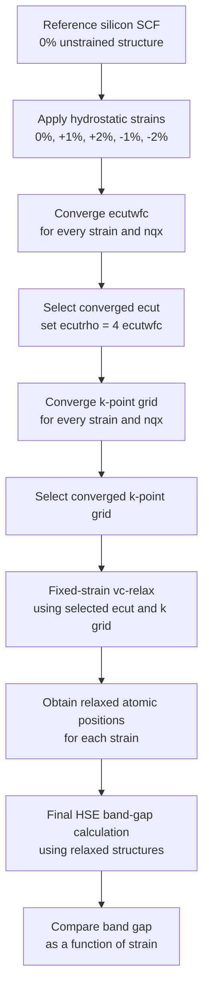

# Silicon HSE Orchestration Workflow

This document describes the calculation stages generated by `orchestrate.py`.
The script is located in `MATE250-FinalProject/` and uses the reference files
under `ReferenceFiles/`.

## Project layout

```text
MATE250-FinalProject/
├── orchestrate.py
├── ReferenceFiles/
│   ├── Si_ONCV_PBE-1.2.upf
│   ├── hse_cal/
│   │   ├── si.scf.in
│   │   └── submit.sh
│   └── vcrelax/
│       ├── si.opt.in
│       └── submit_gpuqs.sh
├── generated_runs/
└── .orchestrate_state.json
```

The pseudopotential path is generated relative to each calculation directory.
The SCF `outdir` remains `./Si_out/`.

## State tracking

The script records progress in `.orchestrate_state.json`. It uses completed
results to decide which stage to generate next.

```bash
cat .orchestrate_state.json
python3 orchestrate.py --recover-state
```

Use `--recover-state` if the JSON state file is missing or no longer matches
the directories already present in `generated_runs/`.

## Stage 0: generate the reference sweep

Stage 0 prepares the Stage 1 calculations from `ReferenceFiles/hse_cal/`.
The generated inputs use:

- strains: `0%`, `+1%`, `+2%`, `-1%`, `-2%`
- HSE auxiliary grids: `nqx = 3` and `nqx = 4`
- wave-function cutoffs: `30, 35, 40, 45, 50, 60, 70, 80 Ry`
- charge-density cutoff: `ecutrho = 4 * ecutwfc`

Generate only:

```bash
python3 orchestrate.py
```

Generate and submit with Slurm:

```bash
python3 orchestrate.py --submit
```

This creates 80 calculations:

```text
generated_runs/stage_1.0_0pct/nqx_3/ecut_30Ry/
generated_runs/stage_1.0_0pct/nqx_3/ecut_35Ry/
...
generated_runs/stage_1.4_minus2pct/nqx_4/ecut_80Ry/
```

## Stage 1: ecut convergence

Stage 1 is the cutoff-convergence sweep. After the jobs finish, continue with:

```bash
python3 orchestrate.py --continue
```

The script reads the total energy from each Quantum ESPRESSO output and checks
adjacent cutoff values using `STAGE1_ENERGY_TOL_RY = 1.0e-4` Ry.

When the first adjacent pair satisfies the tolerance, the script selects the
larger cutoff. For example, if `60 Ry` and `70 Ry` are the first converged pair,
the selected cutoff is `70 Ry`.

The selected cutoff is stored in the state file and the convergence plot is
written to:

```text
generated_runs/ecut_convergence.png
```

Stage 1 then prepares Stage 2, unless Stage 2 has already been generated.

## Stage 2: k-point convergence

Stage 2 uses the selected Stage 1 cutoff separately for every strain and `nqx`.
It tests the following Monkhorst-Pack grids:

```text
6x6x6, 8x8x8, 10x10x10, 12x12x12, 14x14x14
```

There are 50 Stage 2 calculations:

```text
5 strains × 2 nqx values × 5 k-point grids = 50
```

The convergence criterion is total-energy convergence in Ry, controlled by
`STAGE2_ENERGY_TOL_RY = 1.0e-4`. The script selects the larger k-point grid in
the first adjacent converged pair.

If Stage 2 inputs were generated but not submitted, submit the existing runs:

```bash
python3 orchestrate.py --continue --submit
```

After Stage 2 jobs finish, analyze them with:

```bash
python3 orchestrate.py --continue
```

The Stage 2 plot is written to:

```text
generated_runs/kpoint_convergence.png
```

The selected cutoff and k-point grid for every strain and `nqx` are retained
in `.orchestrate_state.json`.

## Stage 3: fixed-strain vc-relax

After Stage 2 is complete, continue again:

```bash
python3 orchestrate.py --continue
```

Stage 3 creates one vc-relax calculation for each combination of:

- `0%`, `+1%`, `+2%`, `-1%`, and `-2%` strain
- `nqx = 3` and `nqx = 4`

This produces 10 calculations. Each input uses the converged Stage 1 cutoff and
the converged Stage 2 k-point grid for its strain and `nqx` value. It is based
on `ReferenceFiles/vcrelax/si.opt.in` and copies the GPU submission script:

```text
submit_gpuqs.sh
```

Because this workflow preserves the imposed hydrostatic strain, Stage 3 sets:

```text
cell_dynamics = 'none'
```

The atomic positions and lattice vectors from the strained input are retained;
the ionic coordinates may relax while the cell remains fixed.

Stage 3 directories have this form:

```text
generated_runs/stage_3_vcrelax/stage_1.0_0pct/nqx_3/
generated_runs/stage_3_vcrelax/stage_1.4_minus2pct/nqx_4/
```

Generate and submit Stage 3 together:

```bash
python3 orchestrate.py --continue --submit
```

If inputs already exist and only submission is needed, use the same command.

## Complete workflow

```bash
# From MATE250-FinalProject/
python3 orchestrate.py --submit

# After Stage 1 jobs finish: analyze Stage 1, generate and submit Stage 2
python3 orchestrate.py --continue --submit

# After Stage 2 jobs finish: analyze Stage 2, generate and submit Stage 3
python3 orchestrate.py --continue --submit
```

If you prefer to inspect each stage before submission, omit `--submit`, review
the generated `.in` files, then rerun with `--continue --submit`.

## Scientific workflow

The scientific sequence is:

1. Run a reference silicon SCF calculation for the unstrained (`0%`) structure.
2. Converge `ecutwfc` for the reference strain and all imposed strains.
3. Using the selected cutoff, converge the k-point grid for every strain.
4. Relax the atomic structure at fixed imposed strain using the converged
   cutoff and k-point grid.
5. Perform the final HSE band-gap calculation using the relaxed structure and
   converged numerical parameters.

The `0%` reference strain is included in every convergence sweep. The `+1%`,
`+2%`, `-1%`, and `-2%` cases are hydrostatic strains applied to all lattice
vectors. The relaxation stage keeps those imposed lattice vectors fixed while
relaxing the internal ionic positions.

## Scientific flowchart



At the final step, extract the band gap consistently for every strain using the
same band-count convention and the converged `ecut`, k-point grid, and HSE
`nqx` settings selected in the earlier stages.

## Useful commands

```bash
# View your running and pending jobs
squeue -u "$USER"

# Cancel all of your Slurm jobs
scancel -u "$USER"

# Find calculation output files
find generated_runs -type f \( -name "*.out" -o -name "*.log" \) | sort

# See the current stage and saved convergence choices
cat .orchestrate_state.json
```

## Important checks

Before continuing to the next stage, verify that the prior stage has a usable
Quantum ESPRESSO output for every expected calculation. A missing output,
failed job, or output without a final total energy prevents reliable automatic
convergence selection. Fix or resubmit that calculation before running
`--continue`.
